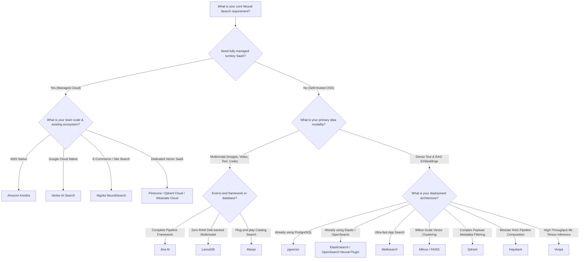

  

  
  
  
  
  
  

---

# 🧠 Awesome Neural Search Frameworks & Vector Retrieval Engines

> **A curated developer index of cutting-edge Neural Search Frameworks, Vector Databases, Semantic Search Engines, and Multimodal Retrieval Architectures for Generative AI and Enterprise RAG.**

Neural search reimagines traditional keyword search (such as BM25 and inverted indexing) by leveraging deep learning embeddings, high-dimensional vector similarity algorithms (HNSW, IVF, DiskANN), and transformer-based cross-encoders. Rather than matching lexical tokens, neural search platforms understand deep **semantic meaning**, **contextual nuances**, and **cross-modal relationships** across text, images, video, audio, code, and structured tables.

---

## 📑 Table of Contents

- [🌟 Core Concepts: Keyword vs. Semantic vs. Neural Search](#-core-concepts-keyword-vs-semantic-vs-neural-search)
- [📊 Sector Overview & Market Dynamics](#-sector-overview--market-dynamics)
- [🏢 SaaS & Managed Neural Search Platforms](#-saas--managed-neural-search-platforms)
- [⚡ Open-Source Neural Search Frameworks (Ranked by Stars)](#-open-source-neural-search-frameworks-ranked-by-stars)
  - [1. Elasticsearch](#1--elasticsearch-)
  - [2. Meilisearch](#2--meilisearch-)
  - [3. Milvus](#3--milvus-)
  - [4. FAISS](#4--faiss-)
  - [5. Qdrant](#5--qdrant-)
  - [6. Chroma](#6--chroma-)
  - [7. Haystack](#7--haystack-)
  - [8. pgvector](#8--pgvector-)
  - [9. Jina](#9--jina-)
  - [10. Weaviate](#10--weaviate-)
  - [11. OpenSearch](#11--opensearch-)
  - [12. LanceDB](#12--lancedb-)
  - [13. Vespa](#13--vespa-)
  - [14. Marqo](#14--marqo-)
  - [15. Infinity](#15--infinity-)
  - [16. USearch](#16--usearch-)
  - [17. Apache Lucene](#17--apache-lucene-)
- [🧩 Architectural Comparison Matrix](#-architectural-comparison-matrix)
- [🛠️ How to Choose the Right Neural Search Stack](#️-how-to-choose-the-right-neural-search-stack)
- [🤝 How to Contribute](#-how-to-contribute)
- [⚠️ Disclaimer](#️-disclaimer)
- [⭐ Star History](#-star-history)
- [💖 Support & Sponsoring](#-support--sponsoring)

---

## 🌟 Core Concepts: Keyword vs. Semantic vs. Neural Search

| Paradigm | Primary Mechanism | Modalities | Key Strengths | Limitations |
| :--- | :--- | :--- | :--- | :--- |
| **Keyword Search** (Lexical) | Inverted index, BM25, TF-IDF | Text only | Exact keyword matches, catalog SKU search, deterministic speed | Suffers from vocabulary mismatch, zero typo comprehension, misses synonyms |
| **Semantic Search** | Dense embeddings, cosine / dot product distance | Text & tabular | Understands synonyms, intent, and paraphrased user queries | Requires separate embedding models; potential high memory and latency |
| **Neural Search** | Deep neural networks, multimodal tensors, multi-stage rerankers | Text, Image, Audio, Video, Code | End-to-end embedding generation, multi-vector representations, cross-modal retrieval | Higher compute and storage demands; requires GPU acceleration or vector quantization |
| **Hybrid Search** | Reciprocal Rank Fusion (RRF) combining BM25 + Dense Vectors | Multimodal + Text | Best-of-both-worlds: combines precise keyword recall with semantic intent | Requires tuning balance alpha weights and synchronizing dual index pipelines |

---

## 📊 Sector Overview & Market Dynamics

The global **Neural Search & Vector Retrieval** market is currently estimated between **$2.1 Billion and $2.7 Billion** and is projected to surge beyond **$8.5 Billion to $9.0 Billion by 2030**, clocking a rapid compound annual growth rate (**CAGR of ~25%–29%**) driven by the explosion of Generative AI, enterprise Retrieval-Augmented Generation (RAG), and agentic workflows.

The sector exhibits **moderate fragmentation**: while hyperscale cloud incumbents (such as Google Cloud, AWS, and Microsoft Azure) capture high-volume managed enterprise search workloads, specialized high-performance vector databases and neural retrieval engines (such as Qdrant, Pinecone, Weaviate, Milvus, and Vespa) retain strong developer defensibility through open-source adoption, superior hybrid search architectures, and specialized indexing algorithms (HNSW, DiskANN, payload filtering). Consequently, the market is not a singular "winner-take-all" landscape, but rather a rapidly evolving dual-layer ecosystem of hyperscale cloud suites and best-of-breed specialized vector engines.

---

## 🏢 SaaS & Managed Neural Search Platforms

The table below catalogs premier hosted and fully managed SaaS neural search platforms, **sorted in descending order by company scale** (valuation, market capitalization, or ARR). Each entry details explicit starting tier pricing and specific free trial / free tier limits.

| 🏢 Platform / Service | 📈 Company Scale (Valuation / Market Cap / ARR) | 💵 Starting Tier Pricing | 🎁 Free Tier / Free Trial Limits | 🎯 Core Capabilities & Best For |
| :--- | :--- | :--- | :--- | :--- |
| **[Google Cloud Vertex AI Search](https://cloud.google.com/enterprise-search)** | **Market Cap:** ~$2.10 Trillion *(Alphabet Inc. / Google Cloud ~$36B+ ARR)* | **$10.00** per 1,000 search queries (standard unstructured/structured search); $0.10/GB storage/month | **90-Day Free Trial** with **$300 Google Cloud credits** + **1,000 search queries/month free forever** | Enterprise turnkey multimodal search across Google Drive, BigQuery, web, and custom document repositories with automated embeddings and RAG pipelines. |
| **[Amazon Kendra](https://aws.amazon.com/kendra/)** | **Market Cap:** ~$1.95 Trillion *(Amazon.com, Inc. / AWS ~$105B+ ARR)* | **$1.125 / hour** (~$810 / month base Developer Edition); additional query units at $0.35/hour | **30-Day Free Trial** providing up to **750 hours of Developer Edition index usage** and up to **10,000 indexed documents** | AWS-native enterprise search with pre-built connectors for S3, SharePoint, and Salesforce; best for organizations deeply integrated into AWS. |
| **[Elastic Cloud](https://www.elastic.co/cloud)** | **Market Cap:** ~$9.00 Billion *(Elastic N.V. - NYSE: ESTC, ~$1.3B ARR)* | **$95.00 / month** ($0.1319 / hour for 2GB RAM / 45GB storage standard tier) | **14-Day Free Trial** featuring up to **2 zones, 8GB RAM, and 240GB storage** (no credit card required) | Full-featured hosted Elasticsearch and Kibana with native HNSW vector search, hybrid dense/sparse BM25 scoring, and enterprise log analytics. |
| **[Algolia](https://www.algolia.com/)** | **Valuation:** $2.25 Billion *(Series D; estimated ~$250M ARR)* | **$0.50 per 1,000 search requests** (Grow Plus tier); $1.00 per 1,000 requests for NeuralSearch | **Free Forever "Build" Plan**: includes **10,000 search requests/month**, **50,000 records**, 5,000 recommendation requests, and 5,000 crawls | Ultra-low latency e-commerce and site search with typo tolerance, instant instant-as-you-type UX, and AI NeuralSearch. |
| **[Pinecone](https://www.pinecone.io/)** | **Valuation:** $750 Million *(Series B)* | **$20.00 / month flat** (Builder Plan) or **$50.00 / month min. usage commit** (Standard Serverless; $0.33/GB storage + $4/M write units + $16/M read units) | **Free Forever "Starter" Plan**: includes **2 GB storage (~300,000 1536-dim vectors)**, **2,000,000 write units/month**, **1,000,000 read units/month**, and up to 5 serverless indexes | Managed serverless vector database engineered exclusively for high-scale RAG, real-time embeddings similarity, and developer ease-of-use. |
| **[Coveo](https://www.coveo.com/)** | **Market Cap:** ~$317 Million USD *(Coveo Solutions Inc. - TSX: CVO, ~$151M ARR)* | **$990.00 / month** (billed annually for entry Salesforce Pro+ integration) | **14-Day Free Trial** with sandbox environment, access to standard enterprise connectors, and relevance ML models (no credit card required) | Enterprise AI search, generative relevance, and customer experience discovery across ServiceNow, Salesforce, SAP, and complex intranets. |
| **[Weaviate Cloud (WCD)](https://weaviate.io/pricing)** | **Valuation:** ~$200 Million *(Series B)* | **$25.00 / month base** (Serverless Production tier; $0.085 per 1M dimensions stored / month) | **Free Forever "Sandbox" Cluster**: **1 cluster**, up to **500,000 vectors** (free auto-renewing or 14-day inactivity sleep, no credit card required) | Managed GraphQL & REST vector search with built-in vectorization modules, multi-tenancy, and hybrid BM25/vector querying. |
| **[Qdrant Cloud](https://qdrant.tech/pricing/)** | **Valuation:** ~$150 Million *(Series A)* | **$25.00 / month** (1 Dedicated Node: 0.5 vCPU, 1GB RAM, 4GB disk, scalable) | **Free Forever Managed Cluster**: **1 node (0.5 vCPU, 1GB RAM, 4GB disk)** supporting **up to ~1,000,000 quantized 768-dim vectors** | Managed Rust-powered vector database with payload-based filtering during HNSW graph traversal and hybrid reciprocal rank fusion. |

---

## ⚡ Open-Source Neural Search Frameworks (Ranked by Stars)

Below is the definitive collection of open-source neural search platforms, vector databases, and similarity engines, **strictly ranked in descending order by GitHub stargazers**. Each project features an official social Stars_Badge linking directly to its stargazer community.

---

### 1. 🔍 [Elasticsearch](https://github.com/elastic/elasticsearch) 

- **Repository**: [elastic/elasticsearch](https://github.com/elastic/elasticsearch)
- **License**: Elastic License 2.0 / SSPL
- **Core Technology**: Java, Apache Lucene, HNSW vector index, ELSER (Elastic Learned Sparse EncodeR)
- **Key Features**:
  - Full-scale distributed search engine powering billions of queries worldwide.
  - Combines traditional BM25 inverted indexes with dense vector HNSW indexing and sparse learned embeddings (`semantic_text`).
  - Reciprocal Rank Fusion (RRF) combines dense vector and lexical scores for state-of-the-art hybrid precision.
  - Native integration with the Elastic stack (Logstash, Beats, Kibana) for unified search, APM, and observability.
- **Best For**: Large organizations with established Elastic infrastructure seeking to incorporate semantic vector search without introducing a standalone database.

---

### 2. ⚡ [Meilisearch](https://github.com/meilisearch/meilisearch) 

- **Repository**: [meilisearch/meilisearch](https://github.com/meilisearch/meilisearch)
- **License**: MIT
- **Core Technology**: Rust, Arroy (HNSW implementation), LMDB
- **Key Features**:
  - Ultra-fast, lightweight, and delightful developer experience with sub-50ms search-as-you-type response times.
  - Native AI-powered **hybrid search** combining BM25 keyword matching with dense vector retrieval.
  - Built-in embedder integration with OpenAI, Hugging Face, Cohere, Ollama, and custom REST vectorizers.
  - Typo tolerance, dynamic filtering, faceting, and geo-search out of the box.
- **Best For**: Front-end applications, SaaS portals, and e-commerce websites demanding instant search responsiveness with effortless semantic enrichment.

---

### 3. 🛡️ [Milvus](https://github.com/milvus-io/milvus) 

- **Repository**: [milvus-io/milvus](https://github.com/milvus-io/milvus)
- **License**: Apache 2.0
- **Core Technology**: Go, C++, Knowhere (vector execution engine), DiskANN, HNSW, IVF-PQ
- **Key Features**:
  - Cloud-native, distributed vector database capable of indexing billions of vector embeddings in production.
  - Decoupled storage and compute architecture utilizing Kubernetes and S3/MinIO object stores.
  - Supports multiple ANN algorithms including HNSW, DiskANN (SSD-optimized vector search), and GPU-accelerated indexes (CAGRA).
  - Rich scalar filtering, multi-vector retrieval, and dynamic schema support for complex RAG metadata.
- **Best For**: Massive billion-scale enterprise vector operations demanding strict high availability, horizontal scaling, and GPU acceleration.

---

### 4. 🧮 [FAISS](https://github.com/facebookresearch/faiss) 

- **Repository**: [facebookresearch/faiss](https://github.com/facebookresearch/faiss)
- **License**: MIT
- **Core Technology**: C++, Python, CUDA
- **Key Features**:
  - Meta AI Research's foundational library for dense vector similarity search and clustering.
  - Pioneered Product Quantization (PQ), Inverted File Indexing (IVF), and GPU-accelerated nearest-neighbor search.
  - Provides mathematical building blocks utilized inside many downstream vector databases.
  - Extremely efficient memory footprint through advanced vector compression algorithms.
- **Best For**: Machine learning researchers, custom embedded C++/Python pipelines, and data scientists requiring raw algorithmic performance and custom distance metrics.

---

### 5. 🦀 [Qdrant](https://github.com/qdrant/qdrant) 

- **Repository**: [qdrant/qdrant](https://github.com/qdrant/qdrant)
- **License**: Apache 2.0
- **Core Technology**: Rust, Custom HNSW with payload-aware graph filtering
- **Key Features**:
  - High-performance vector database with native support for payload-based metadata filtering during graph traversal (preventing post-filtering recall loss).
  - Built-in sparse vector support, dense vectors, and hybrid search with Reciprocal Rank Fusion (RRF).
  - Integrated FastEmbed lightweight embedding generation engine.
  - Binary and scalar quantization for up to 4x reduction in RAM requirements with negligible recall degradation.
- **Best For**: Production RAG systems, complex metadata filtering, recommendation engines, and filter-heavy multimodal neural search.

---

### 6. 🎨 [Chroma](https://github.com/chroma-core/chroma) 

- **Repository**: [chroma-core/chroma](https://github.com/chroma-core/chroma)
- **License**: Apache 2.0
- **Core Technology**: Python, Rust, ClickHouse / SQLite / DuckDB
- **Key Features**:
  - The AI-native open-source embedding database focused on developer ergonomics and rapid prototyping.
  - Simple `pip install chromadb` setup with zero external dependencies required for local execution.
  - Out-of-the-box support for document storage, automatic embeddings generation, and metadata filtering.
  - Seamless integrations with LangChain, LlamaIndex, Instructor, and modern generative AI frameworks.
- **Best For**: Rapid prototyping, local developer experimentation, desktop AI applications, and agentic memory buffers.

---

### 7. 🌾 [Haystack](https://github.com/deepset-ai/haystack) 

- **Repository**: [deepset-ai/haystack](https://github.com/deepset-ai/haystack)
- **License**: Apache 2.0
- **Core Technology**: Python, Modular Directed Acyclic Graph (DAG) pipelines
- **Key Features**:
  - Full-stack AI orchestration framework for context-engineered LLM applications, neural search, and RAG.
  - Declarative pipeline design with swappable DocumentStore backends (Qdrant, Weaviate, OpenSearch, pgvector, Chroma, Milvus).
  - Explicit control over dense embedding generation, BM25 retrieval, reciprocal rank fusion (`DocumentJoiner`), and cross-encoder reranking.
  - Hayhooks microservice runner for deploying pipelines as production REST endpoints with one command.
- **Best For**: AI engineers needing predictable, typed pipeline composition and modular retrieval orchestration without vendor lock-in.

---

### 8. 🐘 [pgvector](https://github.com/pgvector/pgvector) 

- **Repository**: [pgvector/pgvector](https://github.com/pgvector/pgvector)
- **License**: PostgreSQL License (BSD-style)
- **Core Technology**: C, PostgreSQL Extension
- **Key Features**:
  - Extends PostgreSQL with native vector similarity search (`vector` data type).
  - Supports HNSW and IVFFlat index types with L2 distance, inner product, and cosine distance operators.
  - Leverages PostgreSQL's battle-tested ACID transactions, replication, point-in-time recovery, and role-based access control.
  - Eliminates the need to maintain a separate vector store when application relational data already resides in Postgres.
- **Best For**: Teams standardizing on PostgreSQL wanting to co-locate vector embeddings and relational entities within a unified database engine.

---

### 9. ☁️ [Jina](https://github.com/jina-ai/jina) 

- **Repository**: [jina-ai/jina](https://github.com/jina-ai/jina)
- **License**: Apache 2.0
- **Core Technology**: Python, gRPC, Docker, Kubernetes, DocArray
- **Key Features**:
  - Cloud-native neural search framework specifically designed for multimodal data: video, audio, image, text, 3D meshes, and source code.
  - Architectural foundation centered on **Documents**, **Executors** (modular processing blocks), and **Flows** (distributed execution graphs).
  - Built-in streaming, paralleling, async scheduling, and containerized deployment across multi-cloud environments.
  - First-class support for state-of-the-art embedding models and multimodal cross-encoders.
- **Best For**: Engineering teams building complete, distributed multimodal search pipelines from scratch that require fine-grained orchestration.

---

### 10. 🌐 [Weaviate](https://github.com/weaviate/weaviate) 

- **Repository**: [weaviate/weaviate](https://github.com/weaviate/weaviate)
- **License**: BSD-3-Clause
- **Core Technology**: Go, HNSW, Custom inverted index
- **Key Features**:
  - Cloud-native vector search engine that stores both raw objects and vector embeddings.
  - GraphQL, REST, and gRPC client interfaces with built-in multi-tenancy and horizontal replication.
  - Modular vectorizer ecosystem (`text2vec-openai`, `text2vec-transformers`, `multi2vec-clip`, `text2vec-cohere`).
  - Hybrid search blending sparse BM25 scoring with dense vector cosine similarity.
- **Best For**: Developers seeking an intuitive GraphQL-enabled vector database with out-of-the-box model integration and structured filtering.

---

### 11. 🔎 [OpenSearch](https://github.com/opensearch-project/OpenSearch) 

- **Repository**: [opensearch-project/OpenSearch](https://github.com/opensearch-project/OpenSearch)
- **License**: Apache 2.0
- **Core Technology**: Java, Lucene, k-NN plugin (FAISS & NMSLIB backends)
- **Key Features**:
  - Truly open-source 100% Apache 2.0-licensed distributed search and analytics suite.
  - Dedicated Neural Search plugin supporting text-to-vector transformations, model serving, and dense semantic retrieval.
  - Hybrid query scoring with reciprocal rank fusion and normalization processors.
  - Scalable enterprise clustering, automated index lifecycle management, and alerting.
- **Best For**: Enterprises committed strictly to permissive OSI licenses seeking a drop-in open-source alternative to Elasticsearch with built-in neural retrieval.

---

### 12. 📐 [LanceDB](https://github.com/lancedb/lancedb) 

- **Repository**: [lancedb/lancedb](https://github.com/lancedb/lancedb)
- **License**: Apache 2.0
- **Core Technology**: Rust, Apache Arrow, Lance columnar format
- **Key Features**:
  - Developer-friendly embedded vector retrieval database for multimodal AI and RAG applications.
  - Built on top of the modern Lance columnar data format designed specifically for multi-terabyte ML workflows.
  - Zero-copy disk-based vector search; indexes queries directly from NVMe SSDs or S3 without loading vectors into expensive RAM.
  - Native support for Python, JavaScript/TypeScript, and Rust environments.
- **Best For**: Cost-effective multimodal vector search over massive datasets stored on local SSDs or cloud object storage without exorbitant in-memory costs.

---

### 13. 🚀 [Vespa](https://github.com/vespa-engine/vespa) 

- **Repository**: [vespa-engine/vespa](https://github.com/vespa-engine/vespa)
- **License**: Apache 2.0
- **Core Technology**: C++, Java, Custom tensor execution engine
- **Key Features**:
  - The battle-tested AI search and recommendation platform powering hundreds of thousands of queries per second at Yahoo scale.
  - Combines HNSW vector search, BM25 text search, and native tensor and machine learning inference at query evaluation time.
  - Supports multi-phase ranking: match-phase, first-phase, second-phase, and global-phase ranking with ONNX, TensorFlow, and XGBoost models.
  - Vespa Query Language (YQL) provides expressive SQL-like filtering, ranking, and aggregation capabilities.
- **Best For**: High-throughput enterprise search, news feeds, and recommender systems with complex multi-stage neural ranking and serving-time ML inference.

---

### 14. 🛍️ [Marqo](https://github.com/marqo-ai/marqo) 

- **Repository**: [marqo-ai/marqo](https://github.com/marqo-ai/marqo)
- **License**: Apache 2.0
- **Core Technology**: Python, PyTorch, OpenSearch / Vespa backends
- **Key Features**:
  - End-to-end tensor search engine for human-like search across text, images, and multimodal catalogues.
  - Unifies embedding generation, vector storage, and search retrieval within a single streamlined service.
  - Built-in multi-modal capabilities: text-to-image, image-to-image, and image-to-text discovery.
  - Extremely simple Python client: index documents with raw text/URLs and search immediately without managing external vectorizers.
- **Best For**: E-commerce catalog discovery, image galleries, and digital asset management where developer simplicity and out-of-the-box multimodal indexing matter.

---

### 15. ♾️ [Infinity](https://github.com/infiniflow/infinity) 

- **Repository**: [infiniflow/infinity](https://github.com/infiniflow/infinity)
- **License**: Apache 2.0
- **Core Technology**: C++, SIMD acceleration
- **Key Features**:
  - AI-native database explicitly engineered for next-generation LLM applications and RAG systems.
  - Delivers ultra-fast hybrid search uniting dense vectors, sparse vectors, multi-vector tensors (ColBERT-style), and full-text BM25.
  - Leverages cutting-edge hardware optimizations (AVX-512, NEON SIMD) for sub-millisecond similarity scoring.
  - Native integration with RAGFlow for turnkey document parsing and question answering.
- **Best For**: Advanced LLM question answering, ColBERT token-level multi-vector search, and performance-critical RAG infrastructure.

---

### 16. ⚡ [USearch](https://github.com/unum-cloud/usearch) 

- **Repository**: [unum-cloud/usearch](https://github.com/unum-cloud/usearch)
- **License**: Apache 2.0
- **Core Technology**: C++11 header-only, SIMD, Hardware assembly
- **Key Features**:
  - Minimalistic, hyper-fast vector search and clustering engine with zero external dependencies.
  - Up to 10x smaller code footprint than FAISS while delivering equivalent or superior latency and recall.
  - Supports non-Euclidean metrics, sub-byte vector quantization (1-bit, 4-bit, fp16), and memory-mapped disk operations.
  - Polyglot SDK bindings for C++, C, Python, JavaScript/Node.js, Rust, Java, GoLang, Swift, and C#.
- **Best For**: Embedded devices, mobile applications, edge computing, and microservices requiring an ultra-lightweight similarity search engine.

---

### 17. 📜 [Apache Lucene](https://github.com/apache/lucene) 

- **Repository**: [apache/lucene](https://github.com/apache/lucene)
- **License**: Apache 2.0
- **Core Technology**: Java
- **Key Features**:
  - The legendary foundational search library powering Elasticsearch, OpenSearch, Solr, and enterprise search platforms worldwide.
  - Features native HNSW vector indexing and k-NN vector search support in Lucene core (since v9.0).
  - Unrivaled BM25 tokenization, linguistic analysis, stemming, facet counting, and query syntax support.
  - High stability with decades of continuous enterprise optimization and rigorous correctness testing.
- **Best For**: Java-based software engineering teams building custom embedded search engines with deep, low-level index control.

---

## 🧩 Architectural Comparison Matrix

| Project | Primary Language | Indexing Algorithms | Hybrid Search (BM25 + Dense) | Multimodal Support | Storage Footprint | License |
| :--- | :--- | :--- | :--- | :--- | :--- | :--- |
| **Elasticsearch** | Java | HNSW, Inverted Index | ✅ Native RRF | 🔲 Via Plugins / Ingest | In-Memory / Disk Cache | Elastic / SSPL |
| **Meilisearch** | Rust | Arroy (HNSW), Inverted | ✅ Native | 🔲 Via External Embedders | Embedded LMDB (Disk) | MIT |
| **Milvus** | Go / C++ | HNSW, DiskANN, IVF, CAGRA | ✅ Native | ✅ Supported | Distributed / S3 / SSD | Apache 2.0 |
| **FAISS** | C++ / CUDA | IVF-PQ, HNSW, Flat | ❌ Pure Vector | ✅ Vectors of any type | In-Memory / GPU RAM | MIT |
| **Qdrant** | Rust | Filtered HNSW, Sparse | ✅ Native RRF | ✅ Native | In-Memory + MMap Disk | Apache 2.0 |
| **Chroma** | Python / Rust | HNSW | ❌ Pure Vector | ✅ Text / Image Embeddings | SQLite / DuckDB / Disk | Apache 2.0 |
| **Haystack** | Python | Modular Backends | ✅ Native DocumentJoiner | ✅ Native | Backed by Stores | Apache 2.0 |
| **pgvector** | C | HNSW, IVFFlat | ✅ Via PostgreSQL Full-Text | ✅ Vectors of any type | PostgreSQL Tables (Disk) | PostgreSQL |
| **Jina** | Python | Flow-based | ✅ Via Executors | ✅ First-Class Multimodal | Distributed / DocArray | Apache 2.0 |
| **Weaviate** | Go | HNSW, Inverted Index | ✅ Native Hybrid | ✅ Multi2Vec Modules | In-Memory + Disk LSM | BSD-3-Clause |
| **OpenSearch** | Java | HNSW (FAISS/NMSLIB), Lucene | ✅ Native RRF | 🔲 Via Neural Plugin | In-Memory / Disk Cache | Apache 2.0 |
| **LanceDB** | Rust | Disk-based IVF-PQ | ✅ Full-Text + Vector | ✅ Native Multimodal | Lance Columnar (NVMe/S3)| Apache 2.0 |
| **Vespa** | C++ / Java | HNSW, Multi-Phase Inverted | ✅ Native Tensor Rank | ✅ Native Multi-vector | In-Memory / Distributed | Apache 2.0 |
| **Marqo** | Python | HNSW, Inverted Index | ✅ Native Lexical + Tensor | ✅ First-Class Multimodal | Containerized Search | Apache 2.0 |
| **Infinity** | C++ | HNSW, Multi-Vector, BM25 | ✅ Native Full-Stack | ✅ Multi-Vector ColBERT | Memory-mapped Disk | Apache 2.0 |
| **USearch** | C++ | HNSW | ❌ Pure Vector | ✅ Vectors of any type | Single-file MMap | Apache 2.0 |
| **Apache Lucene**| Java | HNSW, Inverted Index | ✅ Native | 🔲 Via Custom Fields | Disk Filesystem | Apache 2.0 |

---

## 🛠️ How to Choose the Right Neural Search Stack

---

## 🤝 How to Contribute

Contributions to keep this repository updated with the latest neural search innovations are warmly welcomed!

1. **Fork this repository** to your GitHub account.
2. **Create a descriptive feature branch**: `git checkout -b add/new-neural-search-tool`.
3. **Add or edit entries** in `README.md` following the established table and list formatting:
   - Provide the tool name, active GitHub repository link, official Stars_Badge, license, and factual 2-3 sentence overview.
   - For SaaS products, verify and include specific starting tier prices and explicit free trial / tier limits.
4. **Ensure links and badges are valid**.
5. **Submit a Pull Request** with a concise summary of the proposed addition.

---

## ⚠️ Disclaimer

- This curated list is maintained by the open-source community for informational and technical reference purposes.
- Mentions of products, companies, or benchmarks do not constitute formal endorsements.
- Benchmarks and vector latency vary significantly based on vector dimensions, index configurations (HNSW `M` and `efConstruction`), quantization strategies, hardware choices (AVX-512 vs. GPU), and metadata predicate complexity. Always benchmark candidates against your application's ground truth datasets.

---

## ⭐ Star History

---

## 💖 Support & Sponsoring

Thank you for exploring this curated repository on **Neural Search Frameworks & Vector Retrieval Engines**! 

If you find this directory valuable for your research, enterprise search architecture, or AI projects, please consider supporting the project:

- ⭐ **Star this repository** on GitHub to help others discover it
- 🍴 **Fork the project** and submit pull requests to add new frameworks or tools
- 📢 **Share** this resource with your colleagues, teams, and developer communities
- ☕ **Sponsor & Buy Me a Coffee**: If you'd like to support ongoing curation and open-source maintenance, please visit the [GitHub Sponsor Dashboard](https://github.com/sponsors/ishandutta2007).

---

  <b>Curated with ❤️ by <a href="https://github.com/ishandutta2007">Ishan Dutta</a> and the Global AI Search Community.</b> 
  <i>Empowering developers to build next-generation multimodal retrieval and neural RAG systems.</i>

